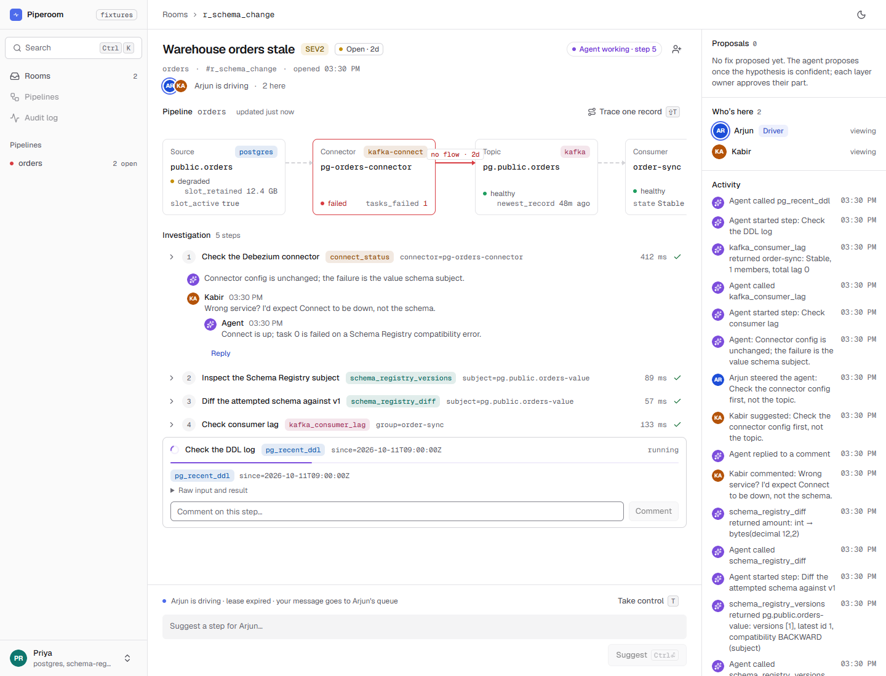
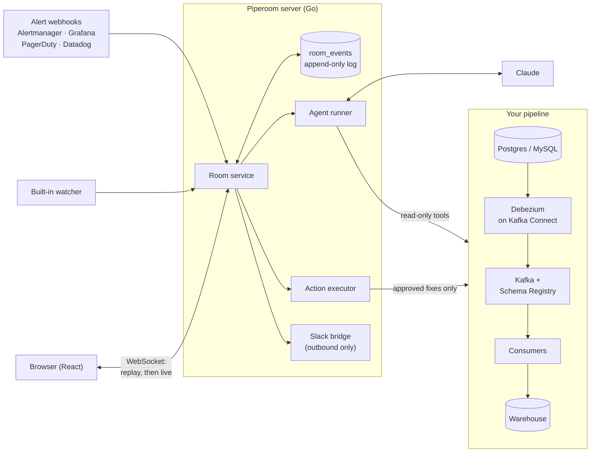
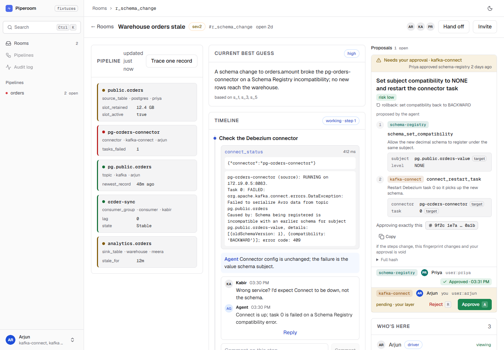

<div align="center">


# Piperoom

**The shared incident room for CDC and Kafka data pipelines.**

When a pipeline breaks, an AI agent investigates every layer with read-only tools,<br>
while your team watches, steers and approves the fix together in one live room.

[](https://github.com/utkarsh199708/piperoom/actions/workflows/ci.yml)
[](https://github.com/utkarsh199708/piperoom/actions/workflows/setup-matrix.yml)
[](go.mod)
[](docs/design/model-providers.md)
[](LICENSE)

[Quickstart](#quickstart) · [How it works](#how-it-works) · [Features](#features) · [Integrations](#integrations) · [Docs](#documentation) · [Status](#project-status)

</div>

<br>

<picture>
  <source media="(prefers-color-scheme: dark)" srcset="web/docs/screenshots/u3/investigating-dark.png">
  
</picture>

## Why Piperoom

A CDC pipeline crosses five systems (the source database, Debezium on Kafka Connect, Kafka, the consumers and the
warehouse) and usually five owners. When it breaks at 3 a.m., the on-call engineer has Connect's REST API in one
tab, `psql` in another and the warehouse in a third, pasting fragments into a Slack thread the next shift cannot
follow. And nobody wants an AI with write access to production.

Piperoom puts the whole incident in one place:

- **One room per incident.** An alert or the built-in watcher opens it. Everyone sees the same live timeline, and
  anyone who joins late can replay it from the first event.
- **An agent does the legwork.** It reads every layer (connector and task status, replication slots, schema
  versions, consumer lag, warehouse freshness) and shows each tool call as a step you can open and comment on.
- **People stay in charge.** One **driver** steers the agent at a time; everyone else suggests. The agent can only
  **propose** a fix, and a fix runs only after the owner of every layer it touches approves it.
- **Shifts hand over cleanly.** At shift change the agent writes the hand-off summary and the driver role moves.

## Quickstart

You need Go 1.27, Node 24, Docker and an `ANTHROPIC_API_KEY`. Pick the path that fits.

### 1. See it on the bundled dev stack (about 10 minutes)

The dev stack runs Postgres → Debezium → Kafka → a consumer → a warehouse in Docker. Break it on purpose and watch
a room open by itself.

```sh
go run ./cmd/devctl lock --owner me                    # the dev stack is shared: take its lock
docker compose -f dev/demo-room-db.yml up -d --wait    # the server's own room database
go run ./cmd/devctl up --owner me                      # start the pipeline

export ANTHROPIC_API_KEY=...                           # from your shell, never from a file
set -a; . dev/demo.env; set +a                         # watcher opens rooms; write mode on (dev stack only)
go run ./cmd/server
```

In a second terminal, start the UI and open the URL it prints. Log in as `arjun`, the driver:

```sh
cd web && npm ci && npm run dev
```

In a third terminal, ship a migration nobody told the data team about:

```sh
go run ./cmd/devctl break schema-change --owner me
```

About a minute later a room opens. The agent traces the failure to a Schema Registry compatibility error and
proposes a fix that the `schema-registry` and `kafka-connect` owners must both approve. The scripted version,
with four roles and fallbacks, is [`docs/demo/schema-change.md`](docs/demo/schema-change.md). When you are done:
`go run ./cmd/devctl down --owner me && go run ./cmd/devctl unlock --owner me`.

### 2. Connect your own pipeline (read-only)

```sh
export CONNECT_URL=... KAFKA_BROKERS=... SCHEMA_REGISTRY_URL=... SOURCE_DB_URL=... WAREHOUSE_DB_URL=...
export ANTHROPIC_API_KEY=...
make quickstart        # discover your pipelines into owners.yaml, build the UI, start on 127.0.0.1
```

Or, with Docker only: `docker compose -f deploy/docker-compose.quickstart.yml up --build`. In quickstart mode the
agent investigates and proposes, but **nothing executes**: approvals are recorded, and the room says fixes are
suggestions. Read-only database and cluster roles are listed in
[`docs/pilot/permissions.md`](docs/pilot/permissions.md). Guide:
[connect an existing pipeline](docs/guides/existing-pipeline.md) ·
[batch pipelines (Airflow + dbt)](docs/guides/batch-pipelines.md).

### 3. Set up a new pipeline from nothing (preview)

```sh
go build -o bin/piperoom-setup ./cmd/setup
mkdir -p orders && bin/piperoom-setup --standalone --project ./orders
```

The same room and approval model take you from an empty directory to a watched Debezium pipeline. The agent plans,
proposes typed operations, you approve, and a runner on your machine executes them; your Docker and cloud
credentials never leave it. Guide: [set up a new pipeline](docs/guides/new-pipeline.md).

## How it works



Every room is an append-only event log. The browser replays it from any sequence number and then follows it live,
so a page reload, a late joiner and an auditor all see exactly the same history.

**The life of an incident**

1. **Open.** An alert, or the watcher noticing a failed task, a growing replication slot or a stalled consumer,
   opens a room for that pipeline.
2. **Investigate.** The agent forms hypotheses and tests them with read-only tools. Every call is a step on the
   timeline with its input, result and duration, and its best guess cites the steps that back it.
3. **Steer.** The driver steers the agent. Everyone else comments on steps and sends suggestions the driver can
   pass on.
4. **Propose.** The agent proposes a fix as typed steps with a risk level, a rollback and, where the action supports
   one, a preview of what will change.
5. **Approve.** The owner of each layer the fix touches approves *exactly this* fix: the approval is pinned to a
   fingerprint of the steps, and any change voids it.
6. **Execute and verify.** The executor runs the approved steps and the agent checks the pipeline recovered.
7. **Hand off.** At shift change the agent writes the summary and the driver role moves; after the incident it
   drafts the post-mortem.

<picture>
  <source media="(prefers-color-scheme: dark)" srcset="web/docs/screenshots/u4/approval-dark.png">
  
</picture>

## Features

### Investigation

- **Read-only tools for every layer:** Postgres and MySQL sources, Debezium and Kafka Connect, Kafka, Schema
  Registry, the warehouse, Prometheus metrics, Connect worker logs, plus Airflow and dbt for batch pipelines.
- **Trace one record** from the source row through the topic to the warehouse.
- **Deep CDC signals:** replication-slot WAL retention, long transactions, TOAST placeholders, duplicate keys,
  snapshot progress, schema history, network and TLS probes.
- **Evidence receipts:** the best guess names the steps behind it, and claims no step backs are flagged.
- **Memory:** `similar_incidents` finds past rooms with the same failure fingerprint, and `runbook_lookup` searches
  your runbooks.

### Collaboration

- A **live room** over WebSocket, replayable from any point, usable from a phone.
- **One driver, many voices:** comment on any step, send suggestions; driver leases expire, so anyone can take over
  from an idle driver.
- **Hand-offs** with an agent-written summary, and a **post-mortem** draft as Markdown.
- A **Slack bridge** that mirrors each room into one thread (outbound only: approvals happen in Piperoom).

### Safety

- **Read-only by default.** Writing is one switch, `PIPEROOM_WRITE_MODE=on`, and quickstart refuses it.
- **Writes exist only as typed actions** that an approved proposal runs. A proposal carries its risk and rollback
  (and a preview where the action supports one), and every approval is pinned to a fingerprint of its steps.
- **Untrusted text is data, never instructions:** logs, record values and error traces are wrapped as untrusted,
  scanned for prompt injection, and redacted of secrets before they reach the model.
- **OIDC single sign-on,** viewer and auditor roles, and an exportable audit trail.

### Fixes the agent can propose

Restart, pause, resume or stop a connector or task · update connector config · tune throughput · set Schema
Registry compatibility · register a schema · reset consumer offsets · replay a dead-letter queue or an offset range
· snapshot a table or re-snapshot rows · add a table to the publication · set replica identity · drop a dead
replication slot · create a heartbeat table · grant `SELECT` · end a blocking session · open a pull request with
the config change.

None of them runs in read-only mode. In write mode each one waits for its layer owners' approvals, unless the
pipeline's owners chose to let that action run on a timer (`auto_approve:` in `owners.yaml`).

## Integrations

| Layer | Supported |
|---|---|
| Source databases | PostgreSQL, MySQL |
| Change data capture | Debezium on Kafka Connect |
| Streaming | Apache Kafka, Schema Registry |
| Warehouses | PostgreSQL, Snowflake, BigQuery, Databricks, ClickHouse |
| Batch | Apache Airflow (REST API v1), dbt (artifacts or dbt Cloud) |
| Metrics | Prometheus (Debezium and Connect metrics) |
| Alerts | Alertmanager, Grafana, PagerDuty, Datadog, a generic signed webhook, and the built-in watcher |
| Chat | Slack (outbound) |
| Model | Claude through the Anthropic API, Amazon Bedrock or Google Vertex AI |
| Sign-in | OIDC; dev login for laptops |
| Deploy | Docker Compose, Helm chart, Terraform (GCP) |

Adapters for OpenAI-compatible, Gemini and Bedrock Converse models are built in. A model from another provider is
listed as supported only after its own eval run matches the Claude baseline
([model providers](docs/design/model-providers.md)).

## Reproducible failures

The dev stack ships 31 breaks, each with its real-world fix, so you can watch the agent on incidents engineers
actually hit:

```sh
go run ./cmd/devctl break <scenario> --owner me     # and: devctl fix <scenario>
```

<details>
<summary><b>All 31 scenarios</b></summary>

| Area | Scenarios |
|---|---|
| Postgres source | `schema-change`, `long-transaction`, `slot-inactive`, `dead-slot`, `missed-table`, `missed-table-kafka-signal`, `no-replica-identity`, `missing-grant`, `blocked-slot`, `idle-wal-growth`, `toast-placeholder` |
| MySQL source | `binlog-purged`, `history-topic-deleted`, `missing-replication-grant`, `server-id-clash` |
| Kafka Connect | `connector-down`, `connector-auth`, `stale-source-offsets` |
| Kafka and consumers | `consumer-stuck`, `consumer-lag`, `consumer-bad-deploy`, `consumer-duplicates`, `consumer-skipped-range`, `dlq-backlog`, `retention-loss`, `rows-lost-after-retention` |
| Warehouse | `sink-filtered-rows`, `sink-dropped-column` |
| Batch | `dag-failed`, `dbt-model-broken`, `late-batch` |

What each one does and looks like: [`dev/scenarios.md`](dev/scenarios.md).

</details>

The same incidents are recorded as [eval scenarios](evals/README.md) that run through the room's own code path, so
a prompt, tool or model change is measured before it ships.

## Deploy

One image holds two binaries: `/piperoom` (the server, its entrypoint) and `/piperoom-setup` (the setup runner). It
starts in **OIDC** mode and refuses to start until `PIPEROOM_PUBLIC_URL`, `PIPEROOM_OIDC_ISSUER`,
`PIPEROOM_OIDC_CLIENT_ID` and `PIPEROOM_OIDC_CLIENT_SECRET` are set; passwordless dev login exists only if you ask for
it with `-f deploy/docker-compose.dev-auth.yml`. Start with [`deploy/README.md`](deploy/README.md) (Compose, single
sign-on, roles, troubleshooting), then [`deploy/helm`](deploy/helm/README.md) for Kubernetes. Pilot limits are in
[`docs/pilot/README.md`](docs/pilot/README.md).

## Documentation

| Guide | What's in it |
|---|---|
| [Read-only quickstart](docs/pilot/quickstart.md) | Your pipelines in a live room in about 5 minutes |
| [Connect an existing pipeline](docs/guides/existing-pipeline.md) | Requirements, `make quickstart`, drafting `owners.yaml` |
| [Set up a new pipeline](docs/guides/new-pipeline.md) | The setup runner, standalone and paired |
| [Batch pipelines](docs/guides/batch-pipelines.md) | Airflow + dbt |
| [Slack bridge](docs/guides/slack.md) | What is mirrored, app setup |
| [Pilot guide](docs/pilot/README.md) | Setup reference, permissions, data handling, write roles |
| [Deploy](deploy/README.md) | Image, Compose, OIDC, Helm |
| [HTTP and WebSocket API](docs/api.md) | The full API contract |
| [Runbook](docs/runbook.md) | Day-to-day operation and common errors |
| [Design docs](docs/design/) | Watcher, replicas, tenancy, retention, setup agent, model providers, ... |
| [Security](docs/security/) | Threat model, findings, tool scope |
| [Evals](evals/README.md) | How agent quality is measured |
| [Development](docs/development.md) | Repo map, dev stack, tests, CI |

## Project status

Piperoom is in **pilot**. Rooms, the agent, approvals, the executor and hand-offs run end to end on the dev stack;
setting up a pipeline from nothing is in preview and grows source by source. Work ships in waves planned on the
boards in [`tasks/`](tasks/).

## How this repo is built

Piperoom is written by a team of AI coding agents. Each agent owns a set of folders and raises pull requests; three
Claude lead agents review architecture and code, and only one of them merges to `main`. The rules every agent
follows (ownership, contract files, coding and test standards) are in [`AGENTS.md`](AGENTS.md), and the
collaboration protocol is in [`docs/collab.md`](docs/collab.md).

## License

Copyright © 2026 Utkarsh. All rights reserved. The source is published for viewing only: no licence is granted to
use, copy, modify or distribute it without written permission. See [`LICENSE`](LICENSE); for licensing enquiries,
contact the copyright holder through GitHub.
